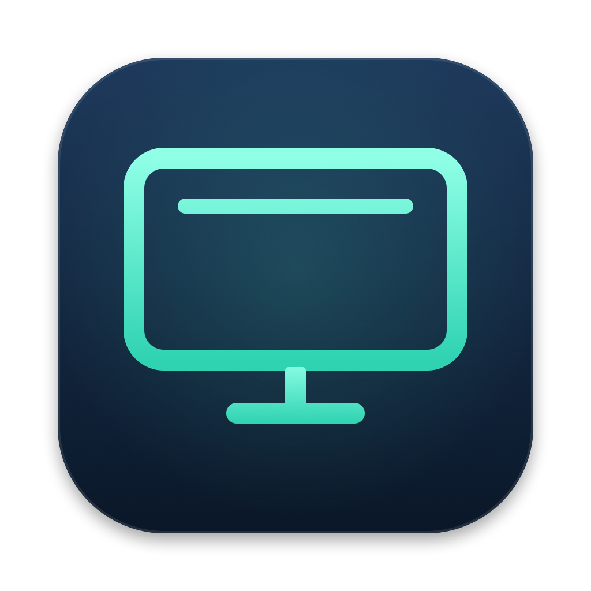

# Display 16X

A free, open-source menu bar utility for the display controls macOS leaves out: every resolution and HiDPI mode, hardware brightness and volume on external monitors, software dimming, and brightness and volume keys that work on a monitor that is not Apple's. By [16X Brains](https://16xbrains.com/), under the MIT License.

It targets Apple silicon, and it is built to do nothing when nothing is happening: no timers, no polling, and nothing that renders frames unless you turn a feature on.

**Status: 0.5.0, with skins, after 0.4.0 brought v0.4 HDR and color, 0.3.0 v0.3 Advanced scaling, and 0.2.0 v0.2 Layout and a redesigned interface (24 November 2026).** The scaling, HDR and color features are off until you switch them on, and the app's own use of them has run in unit tests only. It runs on the developer's Mac with two external monitors and has not been tested on other hardware yet. See [what works](#what-works-today), the [changelog](CHANGELOG.md) for what was checked on hardware in this release, and the [feasibility notes](docs/feasibility.md) for the measurements.

## Install

Releases are published as a Homebrew cask and as a ZIP on the [releases page](https://github.com/engrmnaveed/macdisplay-16x/releases), from 0.2.0 on, for Apple silicon Macs with macOS 14 or later:

```sh
brew install --cask engrmnaveed/tap/display16x
```

Every release so far is ad hoc signed and not notarized by Apple. macOS asks you to allow the first launch in Privacy & Security, and after every update you allow it again and give the Accessibility permission for the brightness and volume keys again. Later releases are to be signed with the project's own certificate, which keeps that permission and Homebrew's first-launch approval from one release to the next.

The [installation guide](docs/install.md) covers Homebrew, the direct download with its checksum and attestation, allowing the first launch, the Accessibility permission, and removal. The [release runbook](docs/release.md) is how a release is made.

## Build and run

You need an Apple silicon Mac with macOS 14 or later and the Command Line Tools (`xcode-select --install`). Xcode is not required.

```sh
swift build
swift test
scripts/package-macos.sh
open "dist/Display 16X.app"
```

The app appears as a display icon in the menu bar and has no Dock icon. Click the icon for one card per display.

- **Safe mode:** hold Shift while the app starts, or pass `--safe`. Nothing is restored or reapplied automatically in safe mode.
- **After sleep and at start:** the app does not push its values at a monitor. It reads the monitor and follows it, so a change made with the monitor's buttons or another tool stays. If a monitor forgets its brightness or volume while asleep, switch on "Put my values back after sleep" on that display's page in the panel, or run `display16x set restoreAfterWake on --tag N`.
- **Verbose log:** pass `--verbose` to log debug detail and echo the log to standard error.
- **Brightness and volume keys** need Accessibility permission. The panel says so and opens the right page in System Settings. The package is ad hoc signed, so macOS asks again after every rebuild: remove the old Display 16X entry from the Accessibility list and add the new one. To keep the grant across rebuilds, create a code signing certificate in Keychain Access (Certificate Assistant, Create a Certificate, type Code Signing) and pass its name: `DISPLAY16X_SIGN_IDENTITY="name" scripts/package-macos.sh`.
- **Pictures of the interface without running it:** `scripts/render-surfaces.sh` draws every surface and state from made-up monitors into `renders/`, in light and dark, with one overview sheet per group. The app is not started and no display is touched. See [The look](#the-look).
- **A build under test next to the copy you use:** set `DISPLAY16X_SUPPORT_DIRECTORY=~/d16x-dev` for the app and for `display16x`, and the build keeps its settings, recovery values and socket in that folder instead of the usual one. Such a build does not start while the normal copy is running, because both would drive the same monitors.

## Checks

Every pull request runs these steps on an Apple silicon runner, and they can be run locally:

```sh
scripts/check-identifiers.sh       # no real display UUIDs in tracked files
swift build
swift test
scripts/package-macos.sh
scripts/smoke-test.sh              # the bundle and the command line tool, read-only
scripts/check-version.sh           # bundle, tool, scripts/release-version and CHANGELOG.md agree
scripts/check-hardened-runtime.sh  # private interfaces resolve the same under the hardened runtime
scripts/archive-macos.sh           # the release ZIP and its SHA-256 file
```

CI also checks the ZIP after `unzip`, as Homebrew unpacks it, and runs `brew style` on the cask rendered for each signing level. The version is written only in `scripts/release-version`.

Captured hardware output that becomes a test fixture carries made-up serial numbers, UUIDs and manufacture dates, never the real ones.

## The look

Choose how the app looks in **Settings → Appearance**, or with `display16x skin`. There are six ready-made skins: **Studio** (the default, navy and aqua), **System** (the accent color chosen in System Settings, on neutral grey, and it follows a change of that color at once), **Graphite**, **Ember**, **Orchid** and **Moss**. **Custom** takes two colors of your own: an accent, and a color the surfaces lean towards. Every skin follows light and dark mode and Increase Contrast, and a choice shows at once on every surface that is open. The menu bar icon stays the system's color.

Custom colors cannot make the interface hard to read. The surfaces keep the lightness of Studio's in each look and take only the hue of your surfaces color; text is moved until it stands out from what it sits on; and the accent moves lighter or darker only as far as it must to be read. An accent that is readable as picked is used as picked. When yours had to move, the Appearance tab says so, and `display16x get skin` gives the colors as drawn.

The interface is drawn in three layers, so that a new look is a small change:

| Layer | File | What it holds |
| --- | --- | --- |
| The skin | `Sources/Display16XApp/Design/Theme.swift` | Every color, distance, size, font, symbol name and duration, as values: Studio written out, and every other skin as one line in `Theme.skins`. `Palette.swift` next to it works a skin's colors out from its two. |
| The pieces | `Sources/Display16XApp/Design/Primitives.swift` | How a bar, a text-size stop, a chip, a card or a banner is drawn from those values. |
| The surfaces | `Sources/Display16XApp/Surfaces/` | Which pieces a surface is made of, and its words. A surface has no color, font, radius, distance or symbol of its own, and picks no skin of its own, and a test fails when one does. |

The app icon is drawn by a script, the way the pieces are: `swift packaging/icon/draw-icon.swift packaging/AppIcon.png` draws the 1024-pixel picture, and `scripts/make-icon.sh packaging/AppIcon.png` makes `packaging/AppIcon.icns` from it with `sips` and `iconutil`. The packaging script puts that file into the bundle. The mark is the one the app draws in its panel and in the menu bar.

A re-skin is held to two measures by the tests: `SkinContrastTests` measures the color pairs of Studio, every ready-made skin, every accent color macOS offers, awkward custom colors and two thousand random ones, in light, dark and both increased-contrast looks; and the render run fails when a control would reach VoiceOver without a name, or when a surface that is open does not take a new skin.

**To add a ready-made skin**, add one line to `Theme.skins`: a name for settings and the command line, the name people see, an accent and a color for the surfaces. Then run `scripts/render-surfaces.sh` and look at `renders/surfaces/sheets/skins-light.png` and `skins-dark.png`, the panel in every skin side by side. The tests measure the new skin on their own.

To check any other change, run `scripts/render-surfaces.sh` and look at `renders/surfaces/sheets/skin-light.png` and `skin-dark.png`, which show every value and piece on one picture, then at the other sheets in that folder. `DISPLAY16X_COMPARE=before:after swift test --filter RenderHarness/compare` lists the pictures that differ between two runs. Countdown rings and the "Last seen" time differ between any two runs.

## Command line

`scripts/package-macos.sh` also produces `dist/display16x`.

```sh
dist/display16x probe                      # hardware report, works without the app
dist/display16x list                       # connected and remembered displays
dist/display16x get brightness --main
dist/display16x set brightness 60% --tag 1
dist/display16x step volume -1 --name "LEN P32p-20"
dist/display16x set resolution 2560x1440 --pointer --try   # asks Keep or Revert, goes back on its own
dist/display16x set restoreAfterWake on --tag 2            # for a monitor that forgets its values while asleep
dist/display16x features                   # every feature and its operations
```

`list` and `probe` say how each connected display is attached: HDMI, USB-C, Thunderbolt, built-in, or not known. That names the Mac's own port. What is at the far end of the cable is not something macOS reports. A `get` says whether the value it returns was read back from the monitor or only sent.

`probe` is read-only and runs on its own, which makes it the thing to attach to a bug report. Every other command is sent to the running app over a socket only your user can open, with a timeout and a clear message when the app is not running. Each display gets one line: `confirmed` (read back from the device), `accepted` (sent or stored, not proven) or `failed` with the reason.

Layout, from v0.2. Fourteen of fifteen hardware checks ran on the two test monitors; a saved layout across a long display sleep with protection on, and the built-in panel coming back when the last external display goes away, are unit-tested only (see the [feasibility notes](docs/feasibility.md#the-owner-checks-23-november-1217-to-1309-the-owner-at-the-desk)):

```sh
dist/display16x arrangement                                   # where every display is
dist/display16x set main on --tag 2 --try                     # asks Keep or Revert
dist/display16x set placement left:end --tag 2 --of-tag 1     # next to another display
dist/display16x set mirror on --tag 2 --of-tag 1
dist/display16x disconnect --tag 2 --try                      # out of use without unplugging
dist/display16x reconnect --all
dist/display16x preset save Desk && dist/display16x preset apply Desk
dist/display16x shortcut add ctrl+opt+1 set preset Desk       # a global shortcut
dist/display16x set protectLayout on                          # put the saved layout back after wake
dist/display16x settings export backup.json
dist/display16x help placement                                # values and an example for any feature
```

Every change to the arrangement, the main display, mirroring or a connection is recorded first, so `display16x revert` (with no display named) puts the last one back. A disconnect lasts for the login session only, and the app reconnects what it disconnected when it quits.

Advanced scaling, from v0.3. Each feature is off until switched on, and anything written outside the app's folder prints its preview and changes nothing until `--confirm` is added:

```sh
dist/display16x set overridesEnabled on
dist/display16x override flexible --tag 2                     # fine HiDPI steps for the display's model
dist/display16x override add 2592x2304 --tag 2                # a size of your own, as the display shows it
dist/display16x override preview                              # every display it reaches, every byte
dist/display16x override apply --confirm                      # administrator password, then a reconnect
dist/display16x override list                                 # every override the app wrote, also without the app
dist/display16x override delete all --confirm                 # removes them, also without the app
dist/display16x set virtualScreens on
dist/display16x virtual create Studio 16:9 2560x1440 hidpi @60 connect
dist/display16x virtual disconnect Studio                     # the definition is kept
dist/display16x set mirrorHiDPI on                            # keeps the GPU busy while it runs
dist/display16x virtual create "LG HiDPI" match mirror=on connect --tag 2
```

HDR and color, from v0.4. Each part is off until switched on. From the panel, and from the command line with `--try`, an HDR or profile change asks Keep or Revert:

```sh
dist/display16x set hdrControls on
dist/display16x hdr on --tag 2 --try                          # System Settings' own switch, then Keep or Revert
dist/display16x hdr headroom --tag 2                          # how far above SDR white it can show
dist/display16x set nightShiftInHDR on                        # Night Shift off while HDR is on, and back after
dist/display16x set profileControls on
dist/display16x color profiles                                # every display profile installed
dist/display16x color profile "Display P3" --tag 2            # or factory for the monitor's own
dist/display16x color hdr-profile "ITU-R BT.2020" --tag 2     # put on when HDR switches on
dist/display16x color modes --tag 2                           # how the link carries the picture, read only
dist/display16x probe --color                                 # HDR and color in the hardware report
```

The look:

```sh
dist/display16x skin                                          # the skin in use, and every skin there is
dist/display16x skin graphite
dist/display16x skin custom accent=#D6336C surfaces=#E8D8C4   # your own colors, kept readable
```

## What works today

| Area | State |
| --- | --- |
| Display records with stable tags, matched across reconnects and restarts | Built, unit-tested, checked on hardware: each monitor kept its tag across restarts, sleeps, a cable replug and a move to another port |
| Resolution list, text-size strip, refresh rate, Keep and Revert with a timed revert | Verified on hardware: size changes from the strip, Keep, Revert, and the revert on its own when unanswered. The list includes the scaled sizes macOS hides from its public mode list |
| DDC brightness, contrast, volume and input, one serial queue per display | Brightness verified on a Lenovo P32p-20 and an LG SDQHD by an independent read. Volume, contrast and mute are read on hardware and written only in unit tests. Input switching is never run on hardware |
| Native brightness for built-in and Apple displays | Built. No such display was available to test |
| Software dimming through color tables | Verified by eye on both monitors: smooth, clearly darker than the monitor's own minimum, back to normal on the way up, and it stays across a lock and unlock. macOS resets color tables at unlock without saying so, so the app writes its table again at wake, at unlock and a few moments after. Dimming left very dark is lifted to a readable level when you come back after the displays were off or the screen was locked for half an hour, and when the app starts. Not checked with a custom color profile. Off by default |
| Brightness and volume keys, on-screen indicator | Verified on both monitors after granting Accessibility. If the grant does not take, remove the old Display 16X entry in System Settings and add it again |
| At start, after wake and when a display returns | The app reads the monitor and shows what it has. Nothing is written. Ran on hardware at one start and at two wakes where the LG left and came back: nothing was written and both monitors still held the values the app had. Not yet seen taking over a value that was changed elsewhere. In five measured wakes, one after five and a half hours, neither test monitor had lost a value |
| "Put my values back after sleep", per display, off by default | For a monitor that forgets its values. Reads first and writes only a value you chose and the monitor no longer has. Built and unit-tested. Never seen repairing a lost value, because neither test monitor loses one |
| Safe mode | Built and unit-tested. Hardware check pending |
| Rotation | Ran once on hardware: 90° on one monitor with the countdown, left unanswered, and the app turned it back after 15 seconds with the arrangement unchanged. Keep and the other angles were not run |
| Launch at login | Built. Not verified |
| CLI and hardware probe | Working |
| More sizes through display overrides, with a preview, an administrator prompt and removal | macOS 27 reading and dropping an override was checked on hardware with a probe. The app's own install, check and removal are unit-tested. Off by default |
| Virtual screens | Created and removed on hardware by a probe. The app's own screens are unit-tested. Off by default |
| Mirror-based HiDPI | Unit-tested only. Off by default, and it keeps the GPU busy while it runs |
| HDR switching, its protection, Night Shift off in HDR | Switching HDR and Night Shift through the same interfaces was checked on hardware with a probe. The app's own use is unit-tested. Off by default |
| Color profiles with a fallback and a profile for HDR, reference presets | Assigning a profile and giving the monitor's own back was checked on hardware with a probe. The app's own use is unit-tested. No display with reference presets was available. Off by default |
| The link's color modes, rates the mode list leaves out, dithering | Read on hardware through the app's own code. Shown only: macOS offers no documented way to choose them |
| Brightness above SDR white | Built up to the color pipeline, which cannot write above white yet, so it does nothing and says so. Off by default |
| Skins: six ready-made and a custom one, in Settings and from the command line | Unit-tested, contrast measured in all four looks, and drawn off screen on every main surface. In daily use in Studio; another skin has not yet been chosen in the running app |

The measurements behind this table are in [docs/feasibility.md](docs/feasibility.md).

## How it is put together

A SwiftPM package with no third-party dependencies.

| Target | Role |
| --- | --- |
| `DisplayCore` | The domain model, with no system dependencies: display records and identity, modes, controls and controllers, composite brightness, the command engine, events, the automation gate, the reconciler and settings. |
| `DDC` | DDC/CI packet codec, lenient reply parsing, one serial queue per display with write coalescing, and a quirks table. |
| `DisplaySystem` | Adapters over public macOS interfaces: inventory, modes, gamma tables, reconfiguration, sleep and wake, audio output, and the hardware probe. |
| `DisplayPrivate` | The only target that touches private interfaces. Every symbol is looked up at run time, and a missing one turns one control off. |
| `Display16XApp` | The menu bar app. The panel's content is built when it opens and released when it closes. |
| `display16x` | The command line tool. |

The menu, the keys and the CLI all build a command and hand it to one command engine. Every automatic write passes one gate, which safe mode keeps closed. Settings are keyed by an app-assigned display tag, never by a system display ID.

- [PRD.md](PRD.md): scope and principles
- [docs/core-architecture.md](docs/core-architecture.md): the design the core is built to
- [docs/roadmap.md](docs/roadmap.md): capabilities, mechanisms and milestones
- [docs/domain-log.md](docs/domain-log.md): what building it taught us about monitors and macOS
- [AGENTS.md](AGENTS.md): rules for working on the project
- [THIRD_PARTY.md](THIRD_PARTY.md): references and credits

## How it is built

Display 16X is designed and directed by its maintainer at 16X Brains, who decides what gets built, approves every change before it reaches `main`, and tests the app in daily use on real monitors. The code is written by Claude, Anthropic's AI model, working as a coding agent under that direction. Every change runs through the unit tests and CI, and the [feasibility notes](docs/feasibility.md) and each release's notes say what was checked on hardware and what was only unit-tested.

## Where your data lives

Settings are one JSON file in `~/Library/Application Support/com.16xbrains.macdisplay16x/`. Nothing leaves your Mac: there are no accounts and no telemetry. Deleting that folder resets the app.

## Limits you should know about

- Private interfaces are used for DDC, native brightness, rotation and the full mode list, so the app cannot be on the Mac App Store, and a macOS update can turn a control off until the app catches up. Without the private mode list the app falls back to the public one, which lacks some scaled sizes.
- A monitor in standby may not answer DDC. The app keeps what it learned and asks again after wake.
- After wake and on reconnect the app puts back only the values you set through it. A change made with the monitor's own buttons is left alone.
- Two identical monitors cannot be told apart for DDC with certainty. The probe says so when it applies.
- DDC changes stay in the monitor after the app quits.
- A display override is for a model: every unit of that model gets it. macOS reads it only when the display connects, and may leave a size out without saying so. Writing and removing one needs an administrator password.
- A virtual screen goes away when the app quits. macOS keeps the color profile it made for one until the screen is discarded through the app.
