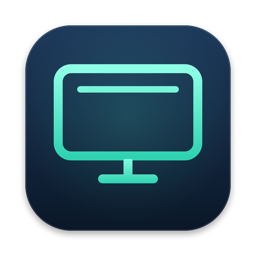
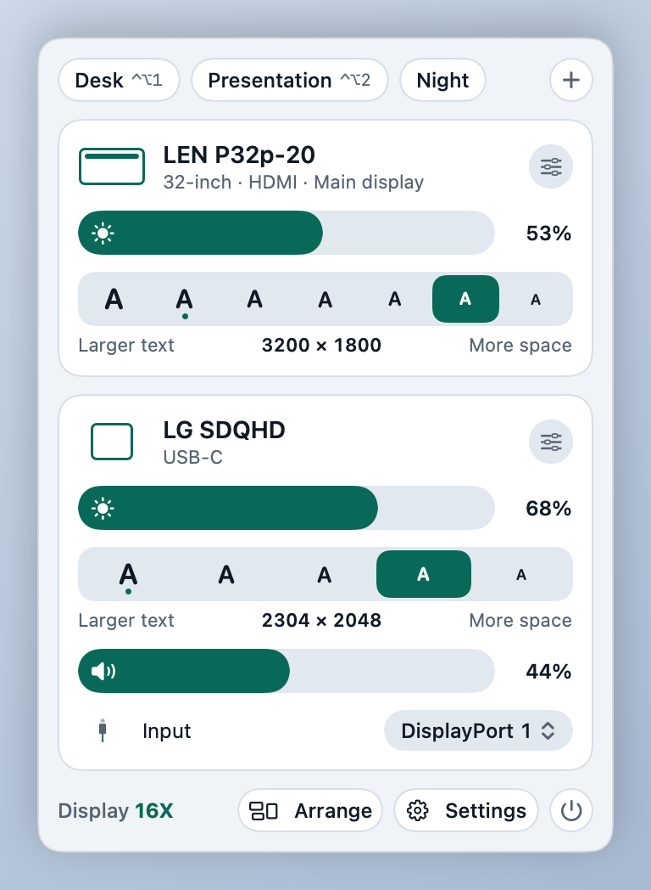
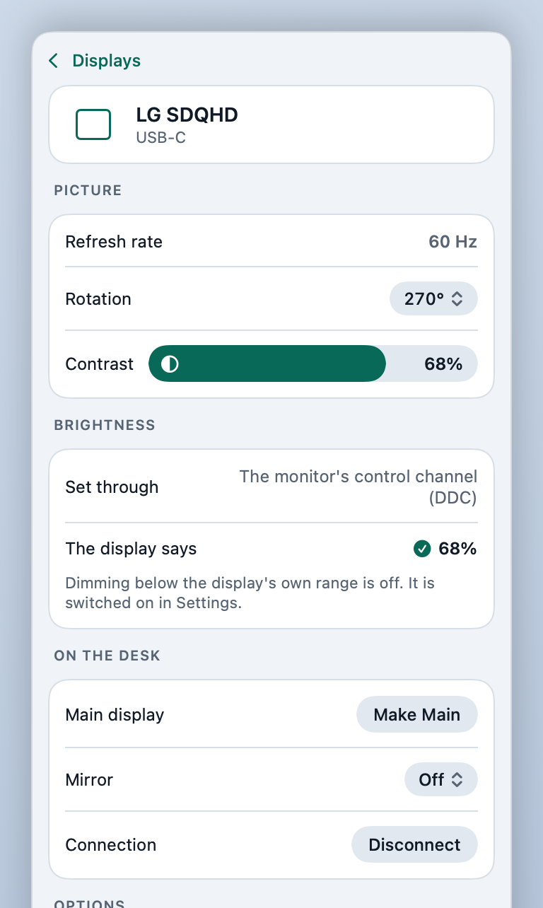
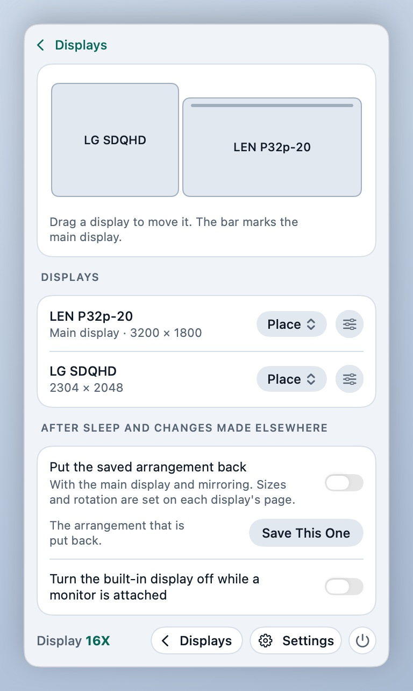
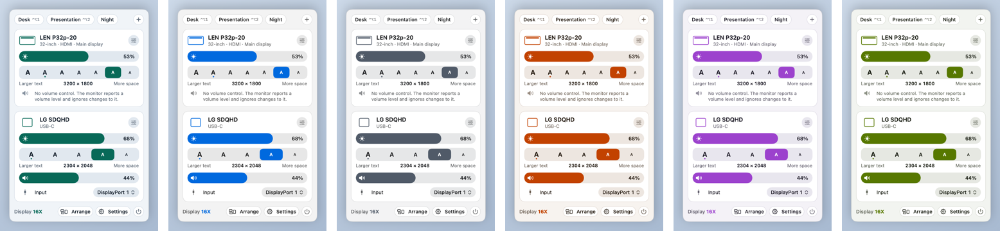

<div align="center">



# Display 16X

**Your external monitors, controlled from the menu bar.**<br>
Hardware brightness and volume, keys that reach the monitor, every text size it can show, and your desk arranged in a click.

[](https://github.com/engrmnaveed/macdisplay-16x/releases/latest)


[](LICENSE)

<picture>
  <source media="(prefers-color-scheme: dark)" srcset="docs/assets/panel-dark.webp">
  
</picture>

<sub>Free and open source, by <a href="https://16xbrains.com/">16X Brains</a>.</sub>

</div>

## Install

```sh
brew install --cask engrmnaveed/tap/display16x
```

<table>
<tr>
<td align="center" width="25%" valign="top">1️⃣<br>Open <b>Display 16X</b> from Applications. macOS stops it once: click <b>Done</b>.</td>
<td align="center" width="25%" valign="top">2️⃣<br>In <b>System Settings → Privacy & Security</b>, click <b>Open Anyway</b>.</td>
<td align="center" width="25%" valign="top">3️⃣<br>Click the display icon in the menu bar. That is the panel.</td>
<td align="center" width="25%" valign="top">4️⃣<br>For the keys, click <b>Open Accessibility Settings</b> in the panel and switch on Display 16X.</td>
</tr>
</table>

> [!NOTE]
> Every release so far is ad hoc signed and not notarized by Apple. After each update, allow the first launch again, and give the Accessibility permission again: remove the old Display 16X entry with <kbd>−</kbd> and add the app with <kbd>+</kbd>. Releases signed with the project's own certificate will keep the Accessibility permission from one version to the next. The [install guide](docs/install.md) has every step, the ZIP download with its checksum, and removal.

## What it does

<table>
<tr>
<td width="50%" valign="top">

☀️ **Brightness and volume**<br>
The monitor's own backlight, contrast and speaker volume, without its buttons. Dims below its lowest step if you like.<br>
<sub>Panel · display page · <code>display16x</code></sub>

</td>
<td width="50%" valign="top">

⌨️ **Keys and shortcuts**<br>
Your Mac's brightness and volume keys reach the monitor under the pointer. Any command can have a global shortcut.<br>
<sub>Keyboard · Settings</sub>

</td>
</tr>
<tr>
<td valign="top">

🔠 **Text size and resolution**<br>
Every size and HiDPI mode, the ones macOS hides too, plus refresh rate and rotation. **Keep** or **Revert**, and it goes back by itself.<br>
<sub>Panel · display page · <code>display16x</code></sub>

</td>
<td valign="top">

🖥️ **Arrangement and scenes**<br>
Drag displays on a desk drawn to scale, pick the main one, mirror, or turn one off without unplugging. Save it all as a scene.<br>
<sub>Arrange · scenes bar · shortcuts</sub>

</td>
</tr>
<tr>
<td valign="top">

🌈 **HDR and color**<br>
Switch HDR, choose a color profile with fallbacks and one for HDR, and keep Night Shift out of HDR.<br>
<sub>Off until you switch it on · unit-tested</sub>

</td>
<td valign="top">

🔍 **More sizes**<br>
Sizes macOS does not offer, screens that exist only in the Mac, and HiDPI for a panel that has none. Shows every byte before it writes.<br>
<sub>Off until you switch it on · unit-tested</sub>

</td>
</tr>
<tr>
<td valign="top">

🎨 **Skins**<br>
Six ready-made looks or two colors of your own, kept readable in light, dark and Increase Contrast.<br>
<sub>Settings → Appearance · <code>display16x skin</code></sub>

</td>
<td valign="top">

💻 **Command line and links**<br>
`display16x` does what the panel does, plus a read-only hardware report. `display16x://` links for Shortcuts and other apps.<br>
<sub>Terminal · links · scripts</sub>

</td>
</tr>
</table>

<p align="center"><a href="docs/user-guide.md"><b>Every feature, step by step, in the user guide →</b></a></p>

## A closer look

<table>
<tr>
<td align="center" width="50%" valign="top">
<picture>
  <source media="(prefers-color-scheme: dark)" srcset="docs/assets/display-page-dark.webp">
  
</picture>
<br><b>A display's page</b><br><sub>Refresh rate, rotation, contrast, its place on the desk</sub>
</td>
<td align="center" width="50%" valign="top">
<picture>
  <source media="(prefers-color-scheme: dark)" srcset="docs/assets/arrange-dark.webp">
  
</picture>
<br><b>Arrange</b><br><sub>Your desk drawn to scale. Drag to move</sub>
</td>
</tr>
<tr>
<td colspan="2" align="center">
<picture>
  <source media="(prefers-color-scheme: dark)" srcset="docs/assets/skins-dark.webp">
  
</picture>
<br><b>Six skins</b><br><sub>Studio · System · Graphite · Ember · Orchid · Moss, or Custom with your own two colors</sub>
</td>
</tr>
</table>

## Works with

| | Setup | What was checked |
|---|---|---|
| 💻 **Mac** | Apple silicon, macOS 14 or later | ✅ Tested on an Apple M5 Pro with macOS 27.2.1 · ⬜ no other Mac or macOS version yet |
| 🖥️ **Lenovo P32p-20** | On the Mac's HDMI port | ✅ Brightness, contrast, keys, text size, rotation, arrangement · the monitor ignores volume |
| 🖥️ **LG SDQHD** | On a USB-C port, as DisplayPort | ✅ Brightness, contrast, volume, keys, text size, arrangement · HDR and profiles switched by test programs |
| 💻 **Built-in XDR panel** | MacBook Pro | ◐ Read through the app: HDR always on, reference presets · brightness not yet tried |
| ❔ **Not tried yet** | | MacBook Air, Apple displays, Thunderbolt docks, adapters and hubs, DisplayLink, two identical monitors |

<sub>✅ checked on hardware · ◐ partly · ⬜ not yet. Brightness, contrast and volume go over the monitor's control channel (DDC/CI), so any monitor that answers it should work the same way. The [feasibility notes](docs/feasibility.md) hold every measurement.</sub>

## Good to know

<table>
<tr>
<td align="center" width="25%" valign="top">💤<br><b>Idle means idle</b><br><sub>No timers, no polling. Nothing draws frames unless you switch a feature on.</sub></td>
<td align="center" width="25%" valign="top">↩️<br><b>Changes can be undone</b><br><sub>Sizes, rotation, layout, HDR and profiles ask <b>Keep</b> or <b>Revert</b>, and go back by themselves after 15 seconds.</sub></td>
<td align="center" width="25%" valign="top">🔒<br><b>Stays on your Mac</b><br><sub>No account, no telemetry. Your settings are one file.</sub></td>
<td align="center" width="25%" valign="top">👀<br><b>Follows your monitor</b><br><sub>At start and after sleep it reads the monitor and writes nothing, unless you ask it to.</sub></td>
</tr>
</table>

**What it does not do:** run on Intel Macs or come from the Mac App Store (it needs private macOS interfaces, which can turn one control off after a macOS update until the app catches up), switch a monitor's input on hardware yet (built, never tried), or control TVs over HDMI-CEC or the network.

<details>
<summary><b>The brightness or volume keys do nothing</b></summary>

1. Open the panel. If it asks for the Accessibility permission, click **Open Accessibility Settings** and switch on **Display 16X**.
2. After an update, the old entry no longer counts, even if it looks switched on. Select it, remove it with <kbd>−</kbd>, add the app with <kbd>+</kbd>, then close and open the panel.
3. **Settings → General** says under the switch whether the keys are heard, and why the last one was passed on to macOS. `display16x status` says the same.
4. The volume keys reach a monitor only while the sound plays through it. **The keys reach** picks the display under the pointer, the one with the active window, or all.

</details>

<details>
<summary><b>A monitor ignores volume or brightness</b></summary>

Each monitor decides which controls it accepts over DDC/CI. After a change, Display 16X reads the value back and sends it again if the monitor dropped it. A monitor that keeps its old value gets a calm note, such as *"LEN P32p-20 kept its volume at 50%."* If it does that again, the app stops offering the control and the card shows **No volume control** in its place. The Lenovo P32p-20 is one such monitor. **Check Again** on the display's page asks the monitor afresh, brightness still goes lower with software dimming (**Settings → General**), and `display16x probe` prints what each monitor answers, read only.

</details>

<details>
<summary><b>macOS blocks the first launch</b></summary>

Open the app once and click **Done**, not **Move to Trash**. Then go to **System Settings → Privacy & Security** and click **Open Anyway**. The button appears only after a try, and for about an hour. Everything about installing is in the [install guide](docs/install.md#allow-the-first-launch).

</details>

<details>
<summary><b>Something about a display went wrong</b></summary>

Hold <kbd>Shift</kbd> while Display 16X starts to open it in **safe mode**: nothing is restored or put back by itself. `display16x revert` puts the last layout change back, and quitting the app reconnects any display it disconnected. More in [Help and safety](docs/guide/troubleshooting.md).

</details>

## Links

📖 [User guide](docs/user-guide.md) · 📦 [Install guide](docs/install.md) · 📝 [Changelog](CHANGELOG.md) · ⬇️ [Releases](https://github.com/engrmnaveed/macdisplay-16x/releases) · 🐞 [Report a problem](https://github.com/engrmnaveed/macdisplay-16x/issues)

<br>

---

<br>

## For contributors

Human or AI agent, read [AGENTS.md](AGENTS.md) first: it holds the working rules and points to the plan.

### How it is built

Display 16X is designed and directed by its maintainer at 16X Brains, who decides what gets built, approves every change before it reaches `main`, and tests the app in daily use on real monitors. The code is written by Claude, Anthropic's AI model, working as a coding agent under that direction. Every change runs through the unit tests and CI, and the [feasibility notes](docs/feasibility.md) and each release's notes say what was checked on hardware and what was only unit-tested.

### Build and run

An Apple silicon Mac with macOS 14 or later and the Command Line Tools (`xcode-select --install`). Xcode is not needed, and the core has no third-party dependencies.

```sh
swift build
swift test
scripts/package-macos.sh
open "dist/Display 16X.app"
```

<details>
<summary>Options for development builds</summary>

- **Safe mode:** hold Shift while the app starts, or pass `--safe`. Nothing is restored or reapplied automatically.
- **Verbose log:** pass `--verbose` to log debug detail and echo the log to standard error.
- **A build next to the copy you use:** set `DISPLAY16X_SUPPORT_DIRECTORY=~/d16x-dev` for the app and for `display16x`, and the build keeps its settings, recovery values and socket in that folder. Such a build does not start while the normal copy runs, because both would drive the same monitors.
- **Keep the Accessibility grant across rebuilds:** the package is ad hoc signed, so macOS asks again after every rebuild. Create a code signing certificate in Keychain Access (Certificate Assistant, Create a Certificate, type Code Signing) and pass its name: `DISPLAY16X_SIGN_IDENTITY="name" scripts/package-macos.sh`.
- **Pictures of the interface without running it:** `scripts/render-surfaces.sh` draws every surface and state from made-up monitors into `renders/`, in light and dark, with one overview sheet per group. No display is touched.

</details>

<details>
<summary>Checks that run on every pull request</summary>

They run on an Apple silicon runner, and locally:

```sh
scripts/check-identifiers.sh       # no real display UUIDs in tracked files
swift build
swift test
scripts/package-macos.sh
scripts/smoke-test.sh              # the bundle and the command line tool, read-only
scripts/check-version.sh           # bundle, tool, scripts/release-version and CHANGELOG.md agree
scripts/check-hardened-runtime.sh  # private interfaces resolve the same under the hardened runtime
scripts/archive-macos.sh           # the release ZIP and its SHA-256 file
```

CI also checks the ZIP after `unzip`, as Homebrew unpacks it, and runs `brew style` on the cask rendered for each signing level. Each release run ends by installing the release from the tap on a Mac that has never had it. The version is written only in `scripts/release-version`, and the [release runbook](docs/release.md) is how a release is made. Captured hardware output that becomes a test fixture carries made-up serial numbers, UUIDs and manufacture dates, never the real ones.

</details>

<details>
<summary>How the code is put together</summary>

A SwiftPM package with no third-party dependencies.

| Target | Role |
| --- | --- |
| `DisplayCore` | The domain model, with no system dependencies: display records and identity, modes, controls and controllers, composite brightness, the command engine, events, the automation gate, the reconciler and settings. |
| `DDC` | DDC/CI packet codec, lenient reply parsing, one serial queue per display with write coalescing, and a quirks table. |
| `DisplaySystem` | Adapters over public macOS interfaces: inventory, modes, gamma tables, reconfiguration, sleep and wake, audio output, and the hardware probe. |
| `DisplayPrivate` | The only target that touches private interfaces. Every symbol is looked up at run time, and a missing one turns one control off. |
| `Display16XApp` | The menu bar app. The panel's content is built when it opens and released when it closes. |
| `display16x` | The command line tool. |

The menu, the keys and the CLI all build a command and hand it to one command engine. Every automatic write passes one gate, which safe mode keeps closed. Settings are keyed by an app-assigned display tag, never by a system display ID.

</details>

<details>
<summary>The look: skins, pieces and surfaces</summary>

The interface is drawn in three layers, so that a new look is a small change:

| Layer | File | What it holds |
| --- | --- | --- |
| The skin | `Sources/Display16XApp/Design/Theme.swift` | Every color, distance, size, font, symbol name and duration, as values: Studio written out, and every other skin as one line in `Theme.skins`. `Palette.swift` next to it works a skin's colors out from its two. |
| The pieces | `Sources/Display16XApp/Design/Primitives.swift` | How a bar, a text-size stop, a chip, a card or a banner is drawn from those values. |
| The surfaces | `Sources/Display16XApp/Surfaces/` | Which pieces a surface is made of, and its words. A surface has no color, font, radius, distance or symbol of its own, and picks no skin of its own, and a test fails when one does. |

- **To add a ready-made skin**, add one line to `Theme.skins`: a name for settings and the command line, the name people see, an accent and a color for the surfaces. Run `scripts/render-surfaces.sh` and look at `renders/surfaces/sheets/skins-light.png` and `skins-dark.png`. `SkinContrastTests` measures the new skin on its own, in light, dark and both increased-contrast looks.
- **To check any other change**, look at `renders/surfaces/sheets/skin-light.png` and `skin-dark.png`, then the other sheets. `DISPLAY16X_COMPARE=before:after swift test --filter RenderHarness/compare` lists the pictures that differ between two runs.
- **The app icon** is drawn by a script: `swift packaging/icon/draw-icon.swift packaging/AppIcon.png`, then `scripts/make-icon.sh packaging/AppIcon.png` makes `packaging/AppIcon.icns`.
- **The pictures in these docs** are renders from `scripts/render-surfaces.sh`, under `docs/assets/`.

</details>

### Where to read more

| Document | What it holds |
|---|---|
| [PRD.md](PRD.md) | Scope and principles |
| [docs/core-architecture.md](docs/core-architecture.md) | The design the core is built to |
| [docs/roadmap.md](docs/roadmap.md) | Capabilities, mechanisms and milestones |
| [docs/feasibility.md](docs/feasibility.md) | What was measured on hardware |
| [docs/domain-log.md](docs/domain-log.md) | What building it taught us about monitors and macOS |
| [THIRD_PARTY.md](THIRD_PARTY.md) | References and credits |

### License

Released under the [MIT License](LICENSE). Display 16X is an independent implementation, written from Apple's documentation, public feature descriptions and openly licensed projects credited in [THIRD_PARTY.md](THIRD_PARTY.md).
