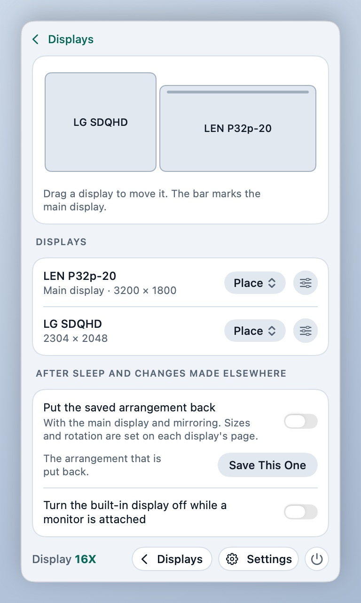

<sub>[User guide](../user-guide.md) › Arrangement</sub>

# 🖥️ Arrangement, main display and mirroring

Move displays around your desk, choose the main one, mirror, or take a display out of use without touching a cable. Every change can be undone.

| Panel | Display page | Keys | Settings | Command line |
|:-:|:-:|:-:|:-:|:-:|
| Arrange | Main, mirror, disconnect | Your own shortcuts | — | Everything |

<picture>
  <source media="(prefers-color-scheme: dark)" srcset="../assets/arrange-dark.webp">
  
</picture>

### Arrange your desk

1. Open the panel and click **Arrange**.
2. Drag a display on the picture. Sizes are to scale, and the bar marks the main display.
3. Or use **Place** next to a display: left of, right of, above or below another.
4. **Keep** or **Revert**. Unanswered, it goes back after 15 seconds.

<br clear="right">

### On a display's page, under On the desk

| Do | How |
|---|---|
| **Make it the main display** | **Make Main**. The menu bar and the Dock move to it |
| **Mirror another display** | **Mirror →** the other display's name. **Mirror → Off** ends it |
| **Take it out of use** | **Disconnect**. It turns off without unplugging, and comes back with **Reconnect** under **Arrange → Off or away** |

Each one asks **Keep** or **Revert**, and `display16x revert` puts the last layout change back at any time.

> [!IMPORTANT]
> A disconnect never strands you. The last display in use is never taken out unless you allow it. A disconnect lasts until you log out at most, and the app reconnects what it disconnected when it quits, at its next start if it stopped unexpectedly, and at once if the last display in use goes away.

### Keep the arrangement as you left it

macOS sometimes shuffles displays after sleep or a reconnect. In **Arrange**, switch on **Put the saved arrangement back**, then **Save This One**. The app puts the arrangement, the main display and mirroring back after a wake, a reconnect or a change made elsewhere. It waits until displays stop coming and going, stops after three tries in two minutes, and says on screen what it did. After you keep an arrangement change, it offers this once.

### The built-in display

**Turn the built-in display off while a monitor is attached**, in Arrange, does what it says. It does nothing while the lid is closed, and displays can be left out of it from the command line. Off by default.

### From the command line

```sh
display16x arrangement                                   # where every display is
display16x set main on --tag 2 --try
display16x set placement left:end --tag 2 --of-tag 1     # left of display 1, bottom edges aligned
display16x set position 0,-1440 --tag 2                  # X,Y in points from the main display
display16x set mirror on --tag 2 --of-tag 1
display16x perform stopMirroring --tag 1
display16x disconnect --tag 2 --try
display16x reconnect --all
display16x perform keepOnlyMain
display16x perform makeOnly --tag 2                      # connect this one, check it, disconnect the rest
display16x revert                                        # the last layout change
display16x set protectLayout on
display16x set autoBuiltInOff on
display16x set turnsBuiltInOff off --tag 3               # this display does not turn the built-in panel off
```

### Good to know

> [!NOTE]
> - Checked on hardware with both test monitors: arranging, the main display, placement, mirroring, disconnect and reconnect, from the command line and the panel with Keep and Revert; reconnecting at quit; a layout put back after it was changed in System Settings; and the built-in panel turned off when the lid opens. These ran before the 0.2.0 redesign of the panel.
> - Not yet tried on hardware: a saved layout across a long display sleep with protection on, the built-in panel coming back when the last external display goes away, and the offer to protect a kept arrangement.

<p align="center"><sub><a href="text-size.md">← Text size</a> · <a href="../user-guide.md">User guide</a> · <a href="scenes-and-shortcuts.md">Scenes, shortcuts and links →</a></sub></p>
