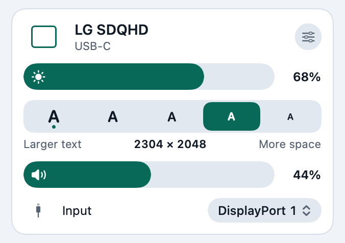
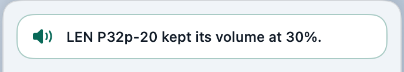
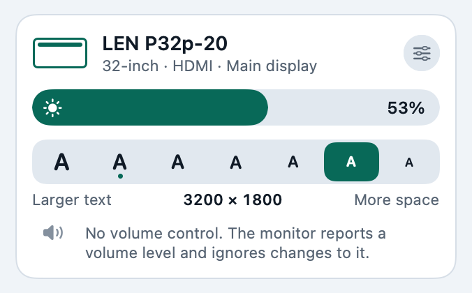
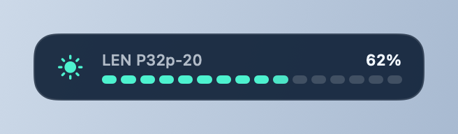

<sub>[User guide](../user-guide.md) › Brightness and volume</sub>

# ☀️ Brightness, contrast and volume

Change a monitor's own backlight, contrast and speaker volume from the menu bar, without reaching for its buttons.

| Panel | Display page | Keys | Settings | Command line |
|:-:|:-:|:-:|:-:|:-:|
| Brightness, volume, mute, input | Contrast, where brightness comes from | Brightness, volume, mute | Keys, dimming | Everything |

<picture>
  <source media="(prefers-color-scheme: dark)" srcset="../assets/card-dark.webp">
  
</picture>

### Use it

1. Click the display icon in the menu bar.
2. Drag the **☀ bar** on a display's card. The percentage sits inside the bar.
3. Drag the **🔊 bar** for volume. Click the speaker symbol to mute.
4. For **contrast**, click the sliders button at the top right of the card. The display's page opens: **Picture → Contrast**.

<br clear="right">

### How a value is known

| The number in the bar | Means |
|---|---|
| **68%** | Read back from the monitor |
| **68%** with a dotted line under it | Sent, and the monitor has not confirmed it, as with dimming. Point at it to see why |
| The same, dimmed | The value the app remembers, for example just after a wake |

The display's page says it in words, such as **✓ The display says 68%**.

### When a monitor does not take a value

After a drag, Display 16X reads the value back from the monitor. If the monitor dropped it, the app sends it again, up to twice.

A monitor that keeps its old value gets a calm note, such as *"LEN P32p-20 kept its volume at 50%."* If it does that again, the app stops offering the control, and the card shows **No volume control** in its place, with the reason. **Check Again** on the display's page asks the monitor again what it supports.

<table>
<tr>
<td align="center" valign="top" width="50%">
<picture>
  <source media="(prefers-color-scheme: dark)" srcset="../assets/note-kept-value-dark.webp">
  
</picture>
<br><sub>The first time: a calm note</sub>
</td>
<td align="center" valign="top" width="50%">
<picture>
  <source media="(prefers-color-scheme: dark)" srcset="../assets/card-no-volume-dark.webp">
  
</picture>
<br><sub>The second time: the control steps aside</sub>
</td>
</tr>
</table>

### Darker than the monitor goes

Switch on **Settings → General → Dim below the monitor's own range**. The bar then carries on below the monitor's lowest step, and macOS darkens the picture. It is off by default and costs nothing while it is on.

> [!TIP]
> Left very dark, dimming is lifted to a readable level when the app starts, and when you come back after the screen was locked or the displays were off for half an hour.

### The brightness and volume keys

| Key | Does |
|---|---|
| <kbd>🔅</kbd> <kbd>🔆</kbd>, or <kbd>F14</kbd> <kbd>F15</kbd> | Brightness of the display the keys reach |
| <kbd>🔉</kbd> <kbd>🔊</kbd> <kbd>🔇</kbd> | Volume and mute of the monitor the sound plays through |
| <kbd>⇧ Shift</kbd> <kbd>⌥ Option</kbd> with any of them | Finer steps |

- **Which display:** **Settings → General → The keys reach**: the display under the pointer (the default), the one with the active window, or all displays. A display that mirrors it changes with it.
- **Leave one out:** switch off **Brightness and volume keys reach this display** on its page, under Options.
- **What you see:** a small indicator names the display that changed.
- **Permission:** the keys need the Accessibility permission. The panel asks for it and opens the right page in System Settings. If they stop working after an update, see [the keys do nothing](troubleshooting.md#the-keys-do-nothing).

<p align="center">
<picture>
  <source media="(prefers-color-scheme: dark)" srcset="../assets/indicator-dark.webp">
  
</picture>
</p>

### After sleep

At start, after a wake and when a display comes back, Display 16X reads each monitor and shows what it has. It writes nothing, so a change made with the monitor's buttons stays.

For a monitor that forgets its values while asleep, switch on **Put my values back after sleep** on its page, under Options. The app then reads first and writes only a value you chose that the monitor no longer has. Off by default.

### From the command line

```sh
display16x get brightness --main
display16x set brightness 60% --pointer
display16x step volume -1 --tag 2
display16x toggle mute --tag 2
display16x set contrast 70% --tag 1
display16x set restoreAfterWake on --tag 2
```

`get` says whether the value was read back from the monitor or only sent. See the [command line](command-line.md) page for more.

### Good to know

> [!NOTE]
> - Brightness, contrast and volume go over the monitor's control channel, DDC/CI, so each monitor decides what it accepts. On the test desk, brightness and contrast were confirmed on both monitors, and volume on one. The other ignores volume.
> - Checking after a drag was tried on hardware: on the LG SDQHD, 60 of 60 checked writes ended on the value asked for, 7 of them after a second send. The calm note and the **No volume control** line are unit-tested and drawn, not yet seen on a real monitor.
> - A brightness key held down sends a run of steps without checking the last one, so a monitor that drops writes while busy can end a step or so short.
> - Mute has been read on hardware but never written. Switching the input is built, asks you to confirm, and has never been run on hardware, because it can cut the Mac off from the monitor.
> - Built-in and Apple displays use macOS's own brightness. Built, not yet tried on such a display.
> - The brightness keys were checked on both monitors with 0.5.1. The volume keys, and the keys reaching a display that mirrors another, are unit-tested and not yet tried on hardware.
> - Software dimming has not been checked with a color profile of your own or with Night Shift. While a profile of your own is assigned through the app, dimming pauses.
> - "Put my values back after sleep" is unit-tested. Neither test monitor ever lost a value, so it has never had to repair one.
> - Changes made over DDC stay in the monitor after the app quits.

<p align="center"><sub><a href="panel.md">← The panel</a> · <a href="../user-guide.md">User guide</a> · <a href="text-size.md">Text size and resolution →</a></sub></p>
