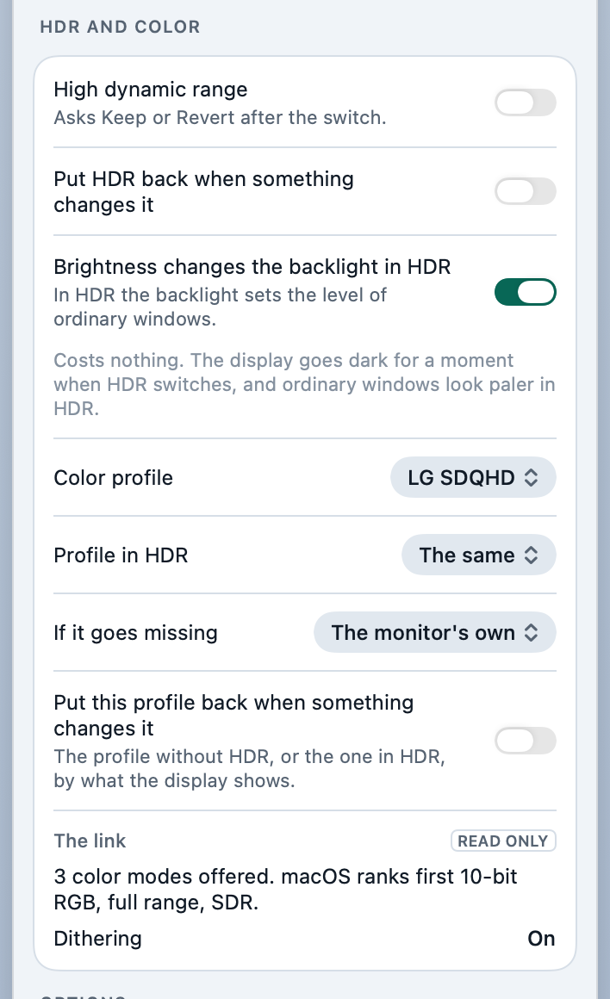

<sub>[User guide](../user-guide.md) › HDR and color</sub>

# 🌈 HDR and color

Switch HDR on the displays that have it, choose color profiles with a fallback and one for HDR, see how the cable carries the picture, and keep Night Shift out of HDR.

| Panel | Display page | Keys | Settings | Command line |
|:-:|:-:|:-:|:-:|:-:|
| — | HDR and color | — | Advanced | Everything |

> [!IMPORTANT]
> Everything here is **off until you switch it on**, in **Settings → Advanced** under HDR and color. Until then Display 16X leaves HDR and color alone. The app's own use of these features is unit-tested; what was proven on hardware is listed at the end.

### Switch it on

| Switch in Settings → Advanced | Lets you | Costs |
|---|---|---|
| **HDR controls** | Switch HDR from a display's page, put it back when something changes it | Nothing while idle |
| **Color profiles** | Choose a display's profile and reference preset | Nothing. Software dimming pauses while a profile of your own is assigned |
| **Night Shift and True Tone off in HDR** | Turn off only what was on while a display shows HDR, and turn it back on afterwards | Needs HDR controls |
| **Brightness above SDR white** | Not active yet, see below | — |

<picture>
  <source media="(prefers-color-scheme: dark)" srcset="../assets/hdr-color-dark.webp">
  
</picture>

### HDR

1. Open the display's page from its card.
2. Under **HDR and color**, switch on **High dynamic range**.
3. The display goes dark for a moment. **Keep** or **Revert**; unanswered, it switches back after 15 seconds.

- **Put HDR back when something changes it** restores it after a wake, a reconnect or a change made elsewhere, and stops after three tries in two minutes.
- **Brightness changes the backlight in HDR**: switch it off to leave the monitor's backlight alone while HDR is on.
- A display that shows HDR at all times, such as a MacBook Pro's XDR panel, reads **Always on**, with nothing to switch.
- Ordinary windows look paler in HDR. That is macOS, not the app.

<br clear="right">

### Color profiles

| On the display's page | Does |
|---|---|
| **Color profile** | The profile in use, or **The Monitor's Own** |
| **Profile in HDR** | Put on when HDR switches on, whoever switched it, and taken off when it switches off |
| **If it goes missing** | Profiles to fall back to, in order. The monitor's own comes last |
| **Put this profile back when something changes it** | Restores it, through the fallback if it must |
| **Reference preset** | Apple displays only: their real presets by name, without the empty slots |

A profile change also asks **Keep** or **Revert**.

### The link, read only

The page shows how the cable carries the picture: color depth, encoding, range, and whether the GPU dithers. The command line also lists refresh rates the link offers that the size list leaves out, such as 24 and 25 Hz at 4K. macOS offers no documented way to choose any of these, so the app shows them and changes nothing.

### Brightness above SDR white

The switch and its controls exist, but **it brightens nothing yet**: the app cannot yet draw a value above white, and the panel and the command line say so.

### From the command line

```sh
display16x set hdrControls on
display16x hdr --tag 2                                   # is HDR on?
display16x hdr on --tag 2 --try                          # asks Keep or Revert
display16x hdr headroom --tag 2                          # how far above SDR white it can show
display16x hdr protect on --tag 2
display16x set nightShiftInHDR on
display16x set profileControls on
display16x color profiles                                # every display profile installed
display16x color profile "Display P3" --tag 2 --try
display16x color profile factory --tag 2                 # the monitor's own
display16x color hdr-profile "ITU-R BT.2020" --tag 2
display16x color fallback "Display P3, sRGB IEC61966-2.1" --tag 2
display16x color preset "Photography (P3-D65)" --tag 1
display16x color modes --tag 2                           # also: rates, dithering
display16x probe --color                                 # HDR and color in the hardware report
```

### Good to know

> [!NOTE]
> - **Proven on hardware by test programs**, on an LG SDQHD: HDR switched on and off through System Settings' own switch, a color profile assigned and the monitor's own given back, and Night Shift switched on and off.
> - **Read on hardware through the app:** the link's color modes, the rates the size list leaves out, dithering, and a MacBook Pro's built-in XDR panel as HDR always on, with its eleven reference presets.
> - **Unit-tested only:** everything the app does with these features by itself, including putting HDR and profiles back, the profile for HDR, and Night Shift off in HDR.
> - HDR and a profile you chose through the app stay after it quits, as if you had set them in System Settings.

<p align="center"><sub><a href="scenes-and-shortcuts.md">← Scenes, shortcuts and links</a> · <a href="../user-guide.md">User guide</a> · <a href="more-sizes.md">More sizes →</a></sub></p>
