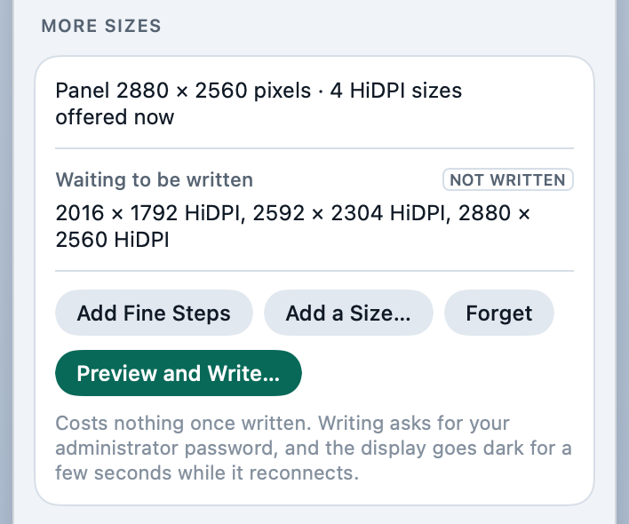

<sub>[User guide](../user-guide.md) › More sizes</sub>

# 🔍 More sizes, virtual screens and HiDPI

For when the sizes macOS offers are not enough: add sizes for a model of display, make screens that exist only in the Mac, or give HiDPI to a panel that has none.

| Panel | Display page | Keys | Settings | Command line |
|:-:|:-:|:-:|:-:|:-:|
| — | More sizes | — | Advanced | Everything |

> [!IMPORTANT]
> Each feature here is **off until you switch it on** in **Settings → Advanced**, and each says what it costs next to its switch. The app's own use of them is unit-tested; what was proven on hardware is listed at the end.

| Switch in Settings → Advanced | Gives you | Costs |
|---|---|---|
| **Scaling through overrides** | More sizes for a model of display | Nothing once the file is written |
| **Virtual screens** | Screens that exist only in the Mac, for headless and remote use | Memory for its picture while one is connected |
| **Mirror-based HiDPI** | A HiDPI virtual screen shown on a panel without HiDPI | Keeps the GPU busy: the whole screen is copied at every refresh |

## More sizes through display overrides

<picture>
  <source media="(prefers-color-scheme: dark)" srcset="../assets/more-sizes-dark.webp">
  
</picture>

1. Switch on **Scaling through overrides**.
2. On the display's page, under **More sizes**, click **Add Fine Steps** for HiDPI sizes across the panel's range, or **Add a Size…** for one of your own. Sizes are typed as the display shows them, turned or not.
3. Click **Preview and Write…**. The preview names every display the file reaches, every step, and the file byte for byte. Nothing is written yet.
4. Click **Write as Administrator…** and enter your password in macOS's own dialog.
5. The display goes dark for a few seconds while the app reconnects it, then the page lists which sizes macOS now offers.

<br clear="right">

> [!WARNING]
> An override is for a **model**, so every unit of that model gets it. macOS may leave out some sizes without saying why, and the page says which. The app does not reconnect the main display: replug its cable or log out and in.

**Undo it any time:** **Remove…** on the display's page takes one override away, and **Settings → Advanced → Remove All…** takes every one the app wrote. Removing works even when the app is not running, from the files themselves: `display16x override delete all --confirm`. A **Full Reset…** can also move macOS's saved display arrangements aside, and **Put Back…** restores them.

## Virtual screens

Screens that exist only in the Mac, for screen sharing, remote access or a Mac with no display.

1. Switch on **Virtual screens**.
2. Click **New Virtual Screen…** in **Settings → Advanced**, or use the command line below.
3. Connect, disconnect or discard it there. A disconnected screen keeps its definition.

- Sizes up to 16384 pixels a side and refresh rates up to 240 Hz. A screen can copy the shape of a connected display, stand in portrait, or offer HDR modes.
- Saved screens come back when the app starts and after a wake. A screen linked to a display connects and disconnects with it.
- macOS moves your displays aside when a screen appears, and the app puts them back. A virtual screen is never counted as a real display, so the last real one in use is never taken out because of it.
- A virtual screen goes away when the app quits. Discarding one also removes the color profile macOS made for it.

## Mirror-based HiDPI

For a panel macOS gives no HiDPI size, the app can show a matching HiDPI virtual screen on it. It starts only for a screen you linked this way, ends when the switch goes off, and `display16x status` says while it runs.

### From the command line

Anything written outside the app's own folder prints its preview and changes nothing until you add `--confirm`.

```sh
display16x set overridesEnabled on
display16x override --tag 2                                   # the model: panel, offered, installed, waiting
display16x override flexible --tag 2                          # fine HiDPI steps
display16x override add 2592x2304 --tag 2                     # a size of your own
display16x override preview                                   # every display it reaches, every byte
display16x override apply --confirm                           # administrator password, then a reconnect
display16x override list                                      # every override the app wrote, also without the app
display16x override delete all --confirm                      # removes them, also without the app

display16x set virtualScreens on
display16x virtual create Studio 16:9 2560x1440 hidpi @60 connect
display16x virtual create Studio 2560x1440 hdr=on connect     # HDR modes next to SDR ones
display16x virtual disconnect Studio                          # the definition is kept
display16x virtual discard all --confirm

display16x set mirrorHiDPI on
display16x virtual create "LG HiDPI" match mirror=on connect --tag 2
```

`display16x help virtualCreate` lists every option for a virtual screen.

### Good to know

> [!NOTE]
> - **Proven on hardware by test programs**, with macOS 27 and an LG SDQHD: macOS reads an override file when the display connects, and removing it brings back exactly the sizes from before. A virtual screen was created and released.
> - **Unit-tested only:** the app's own override write, preview and removal, an override for the main display, the override settings other than sizes, virtual screens made by the app, and mirror-based HiDPI.
> - **Before you remove the app**, remove overrides and virtual screens while it still runs. The [install guide](../install.md#remove-display-16x) has the steps.

<p align="center"><sub><a href="hdr-and-color.md">← HDR and color</a> · <a href="../user-guide.md">User guide</a> · <a href="skins.md">Skins →</a></sub></p>
