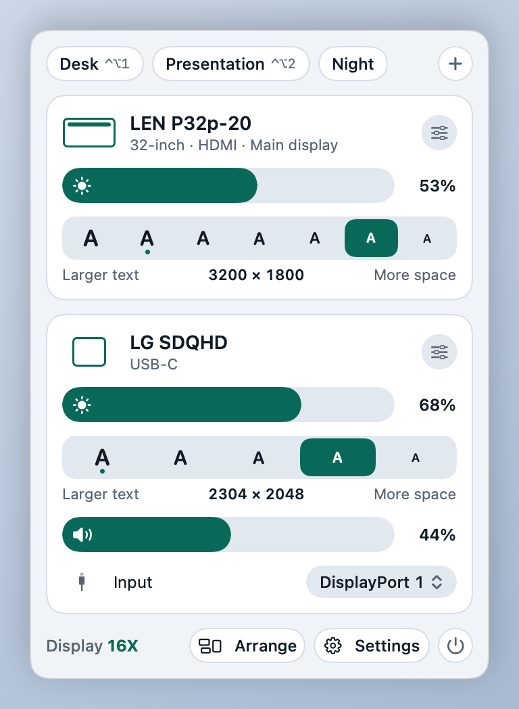
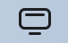
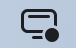
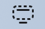
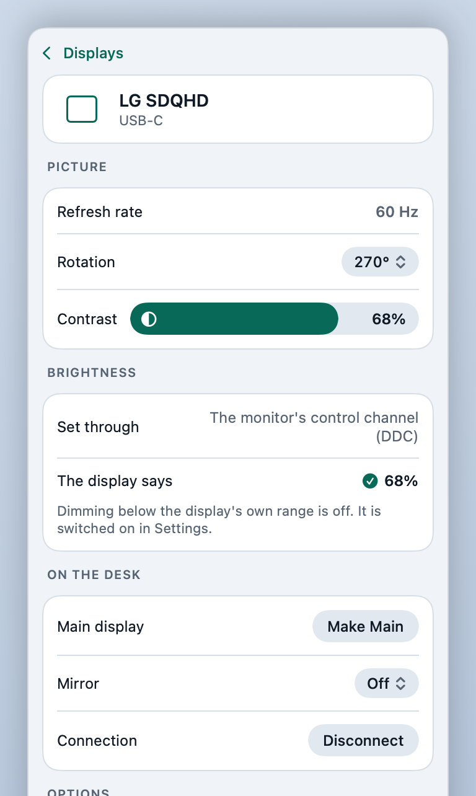

[User guide](../user-guide.md) › The panel

# 🧭 The panel

Everything starts at the display icon in the menu bar. Click it for one card per display. Display 16X has no Dock icon and no window of its own until you open one.

<picture>
  <source media="(prefers-color-scheme: dark)" srcset="../assets/panel-dark.webp">
  
</picture>

### From top to bottom

- **Scenes**: your saved setups, one press each. <kbd>+</kbd> saves the one you have now. See [Scenes](scenes-and-shortcuts.md)
- **A card per display**: its shape drawn to scale, its name, size in inches, how it is connected, and whether it is the main display
- ☀ **Brightness bar**: drag it. See [Brightness and volume](brightness-and-volume.md)
- **Text-size strip**: larger text on the left, more space on the right. The dot marks the display's default. See [Text size](text-size.md)
- 🔊 **Volume bar** and **Input**: only on a monitor that offers them
- **Sliders button**: opens the display's page, one level down
- **Arrange · Settings · ⏻**: your desk drawn to scale, the [settings window](settings.md), and Quit

Anything that needs you comes first, above the cards: a missing permission with its steps, safe mode, or a change that failed. The panel keeps its size and scrolls on a small screen.

 

### The menu bar icon

| Icon | Means |
|:-:|---|
| <picture><source media="(prefers-color-scheme: dark)" srcset="../assets/menu-bar-normal-dark.webp"></picture> | All is well |
| <picture><source media="(prefers-color-scheme: dark)" srcset="../assets/menu-bar-attention-dark.webp"></picture> | Something waits for you in the panel |
| <picture><source media="(prefers-color-scheme: dark)" srcset="../assets/menu-bar-safe-mode-dark.webp"></picture> | [Safe mode](troubleshooting.md#safe-mode): nothing is put back by itself |

The icon keeps the system's color in every skin.

## A display's page

<picture>
  <source media="(prefers-color-scheme: dark)" srcset="../assets/display-page-dark.webp">
  
</picture>

Click the sliders button on a card. Everything about that one display is here, in sections:

- **Picture**: refresh rate, rotation, contrast
- **Brightness**: where it comes from, and what the display says it is
- **On the desk**: make it main, mirror another display, disconnect it
- **HDR and color**: its controls work once switched on in Settings. See [HDR and color](hdr-and-color.md)
- **More sizes**: its controls work once switched on in Settings. See [More sizes](more-sizes.md)
- **Options**: whether the keys reach it, values after sleep, putting its size and rotation back, shortcuts
- **About this display**: the Mac's port it uses, its tag, model and serial number, how it answers, and **Check Again**

**Displays** at the top goes back to the cards.

 

## How the app knows your displays

- Every display gets a **tag**, a small number that stays with it. The command line uses it: `--tag 2`.
- Its settings follow it across restarts, sleep, a cable replug and a move to another port. Checked on hardware with both test monitors.
- A display that is unplugged is remembered for 90 days. **Arrange → Off or away** shows when it was last seen, and **Forget** deletes what was saved for it.
- The card names the **connection by the Mac's own port**: HDMI, USB-C, Thunderbolt or built-in. What is at the far end of the cable, such as an adapter, is something macOS does not report.

> [!NOTE]
> Two identical monitors cannot always be told apart with certainty. `display16x probe` says so when it applies. Telling them apart by port is not built yet.

<a href="../user-guide.md">User guide</a> · <a href="brightness-and-volume.md">Brightness and volume →</a>

