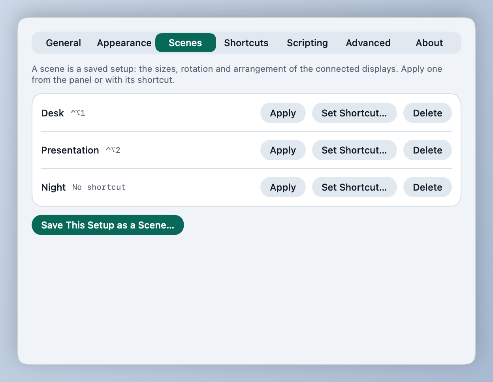

<sub>[User guide](../user-guide.md) › Scenes, shortcuts and links</sub>

# 🎬 Scenes, shortcuts and links

Save a whole setup and bring it back in one press, give any command a keyboard shortcut, or run commands from other apps.

| Panel | Display page | Keys | Settings | Command line |
|:-:|:-:|:-:|:-:|:-:|
| Scenes bar | Shortcuts for that display | Your own shortcuts | Scenes, Shortcuts, Scripting | Everything |

## Scenes

A scene remembers the sizes, rotation and arrangement of the displays that are connected, under a name such as *Desk* or *Presentation*.

<picture>
  <source media="(prefers-color-scheme: dark)" srcset="../assets/settings-scenes-dark.webp">
  
</picture>

1. Set your displays up the way you want them.
2. In the panel, click <kbd>+</kbd> at the end of the scenes bar and give it a name.
3. Later, click the scene's name at the top of the panel to apply it.
4. In **Settings → Scenes**, give it a shortcut with **Set Shortcut…**, apply it or delete it.

<br clear="right">

> [!TIP]
> From the command line a scene can hold brightness too: `display16x preset save Evening modes,rotation,layout,brightness`.

## Shortcuts

Global shortcuts work everywhere on the Mac, and need no permission.

| Add a shortcut for | Where |
|---|---|
| A scene | **Settings → Scenes → Set Shortcut…** |
| More space, larger text, rotate, mirror | A display's page, **Options → Shortcuts → Add** |
| Any command at all | `display16x shortcut add ctrl+opt+1 set preset Desk` |

When recording, press the keys with at least one of <kbd>⌃ Control</kbd>, <kbd>⌥ Option</kbd> or <kbd>⌘ Command</kbd>. <kbd>Esc</kbd> cancels. **Settings → Shortcuts** lists them all, and says when another app holds the same keys.

```sh
display16x shortcut list
display16x shortcut add ctrl+opt+b step brightness +1 --pointer
display16x shortcut add ctrl+opt+r toggle rotation 90 --tag 2
display16x shortcut add cmd+shift+f13 perform keepOnlyMain
display16x shortcut remove ctrl+opt+b
```

## Links

`display16x://` links run a command from the Shortcuts app (its **Open URLs** action), a launcher or a script.

1. Switch on **Settings → Scripting → Links may control this app**. It is off by default.
2. Copy the **token** shown under it. Every link must carry it.
3. Build a link: the operation, then the feature, then the details.

```text
display16x://set/brightness?value=60%25&tag=1&token=YOUR_TOKEN
display16x://step/volume?value=-1&pointer&token=YOUR_TOKEN
display16x://set/preset?value=Desk&token=YOUR_TOKEN
display16x://set/resolution?value=2560x1440&tag=2&try&token=YOUR_TOKEN
```

| Part | Values |
|---|---|
| Operation | `get`, `set`, `step`, `toggle`, `perform` |
| Feature | Any name from `display16x features` |
| Display | `tag=N`, `name=…`, `main`, `pointer`, `focused` or `all`; the other display with `oftag=N` and the like |
| Options | `try`, `confirm` and `exact`, as on the command line |
| Callbacks | `x-success` and `x-error` are opened afterwards with the result |

### Good to know

> [!NOTE]
> - Applying a scene from a shortcut was checked on hardware. Links are unit-tested and not yet tried on hardware.
> - Actions for the Shortcuts app are not built: they need a step that only ships with Xcode. Links do the same job.
> - A scene or shortcut saved by a newer version that this one cannot read is left out and logged, and the rest of your settings stay.

<p align="center"><sub><a href="arrangement.md">← Arrangement</a> · <a href="../user-guide.md">User guide</a> · <a href="hdr-and-color.md">HDR and color →</a></sub></p>
