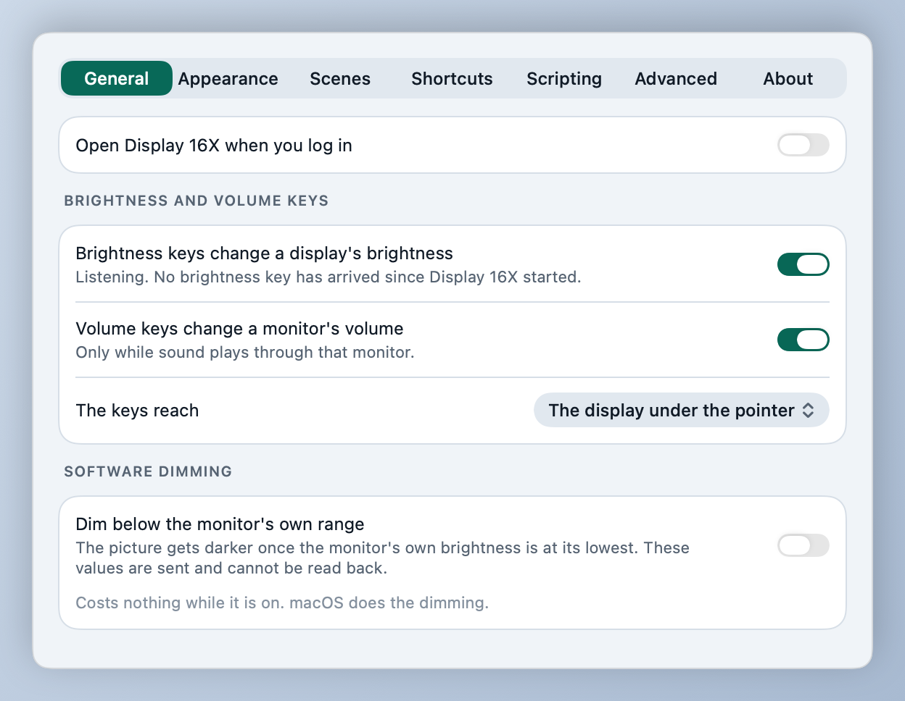

<sub>[User guide](../user-guide.md) › Settings</sub>

# ⚙️ Settings

The settings window holds what applies to the whole app. Open it with **Settings** at the bottom of the panel. What belongs to one display is on that display's page instead.

<p align="center">
<picture>
  <source media="(prefers-color-scheme: dark)" srcset="../assets/settings-general-dark.webp">
  
</picture>
</p>

| Tab | What is in it |
|---|---|
| [**General**](#general) | Opening at login, the brightness and volume keys, software dimming |
| [**Appearance**](#appearance) | The skin |
| [**Scenes**](#scenes) | Your scenes, their shortcuts |
| [**Shortcuts**](#shortcuts) | Every global shortcut |
| [**Scripting**](#scripting) | The command line, links, and your settings file |
| [**Advanced**](#advanced) | More sizes, virtual screens, HDR and color, all off by default |
| [**About**](#about) | Version and links |

### General

| Setting | Does | Default |
|---|---|:-:|
| **Open Display 16X when you log in** | Starts the app at login. macOS may ask you to approve it under Login Items | Off |
| **Brightness keys change a display's brightness** | The line under it says whether the keys are heard, and why the last one went to macOS | On |
| **Volume keys change a monitor's volume** | Only while sound plays through that monitor | On |
| **The keys reach** | The display under the pointer, the one with the active window, or all displays | Under the pointer |
| **Dim below the monitor's own range** | Software dimming below the monitor's lowest step | Off |

### Appearance

Six ready-made skins and Custom with two colors of your own. See [Skins](skins.md).

### Scenes

Every scene, with **Apply**, **Set Shortcut…** and **Delete**, and **Save This Setup as a Scene…**. See [Scenes](scenes-and-shortcuts.md#scenes).

### Shortcuts

Every global shortcut, with **Remove**. A shortcut another app holds is marked, because its keys do not arrive here.

### Scripting

| Setting | Does | Default |
|---|---|:-:|
| **The display16x command may control this app** | Off: the command can still ask for the status | On |
| **Links may control this app** | Lets `display16x://` links run commands. Each link carries the **token** shown here | Off |
| **Export… · Import… · Reset…** | Your whole settings as one JSON file. Reset keeps each display's tag | — |

### Advanced

Each switch says what it costs. Everything here is off until you turn it on.

| Group | Switches |
|---|---|
| **More sizes** | Scaling through overrides · Virtual screens, with **New Virtual Screen…** · Mirror-based HiDPI. See [More sizes](more-sizes.md) |
| **Written outside the app** | What the app wrote outside its own folder, with **Remove All…**, **Full Reset…** and **Put Back…** |
| **HDR and color** | HDR controls · Color profiles · Night Shift and True Tone off in HDR · Brightness above SDR white. See [HDR and color](hdr-and-color.md) |

### About

The version, links to the project page and to 16X Brains, and the license.

## Settings on the command line only

| Setting | Does | Default |
|---|---|:-:|
| `protectionNotices` | Says on screen when a protected setting was put back | On |
| `allowDisconnectAll` | Lets the last display in use be disconnected | Off |
| `mirrorTargetSizes` | Lets the size of a display that mirrors another be changed | Off |
| `turnsBuiltInOff` | Whether a monitor connecting turns the built-in panel off, once that switch in Arrange is on | On |

```sh
display16x get protectionNotices
display16x set allowDisconnectAll on
```

## Where your settings live

One JSON file in `~/Library/Application Support/com.16xbrains.macdisplay16x/`. Nothing leaves your Mac: there is no account and no telemetry. Each display's settings are kept under its tag. Deleting that folder resets the app.

```sh
display16x settings export ~/Desktop/display16x-settings.json
display16x settings import ~/Desktop/display16x-settings.json --confirm
display16x settings reset --confirm
```

> [!NOTE]
> Opening at login is built and not yet verified on hardware. A scene or shortcut that this version cannot read, such as one saved by a newer version, is left out on import and logged, and the rest is kept.

<p align="center"><sub><a href="skins.md">← Skins</a> · <a href="../user-guide.md">User guide</a> · <a href="command-line.md">Command line →</a></sub></p>
