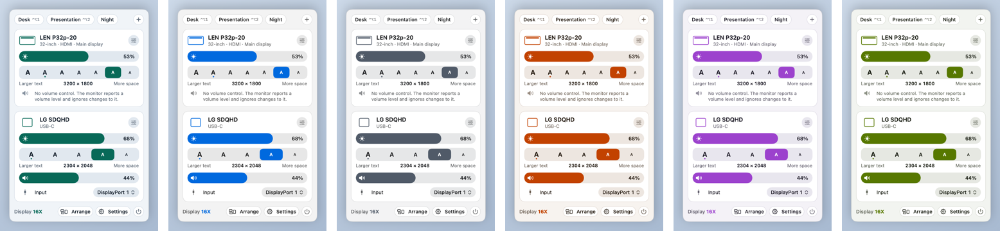
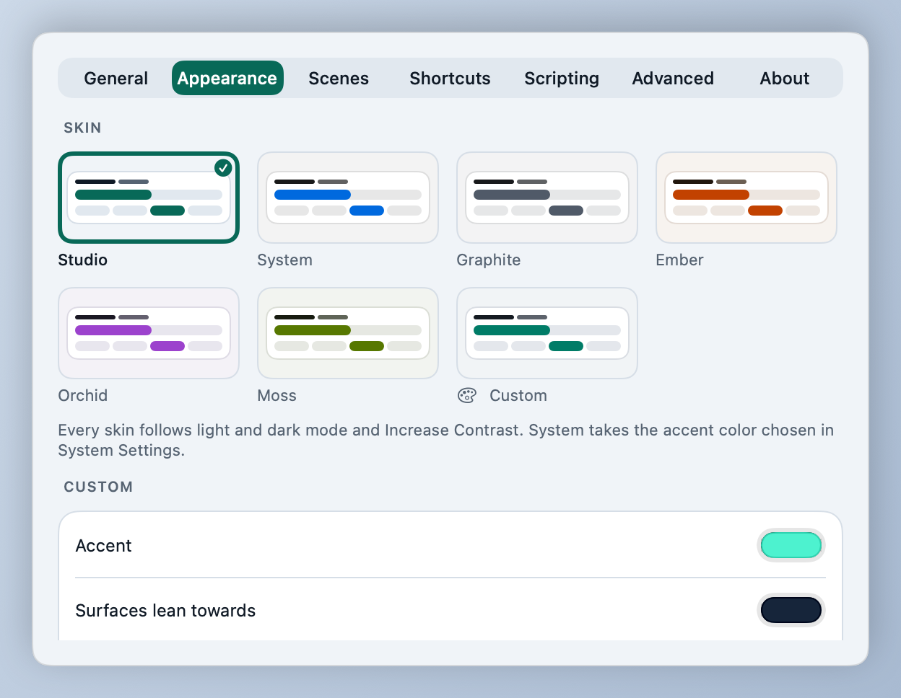

<sub>[User guide](../user-guide.md) › Skins</sub>

# 🎨 Skins

Choose the colors Display 16X is drawn in. A skin changes how the app looks and nothing on your displays.

| Panel | Display page | Keys | Settings | Command line |
|:-:|:-:|:-:|:-:|:-:|
| — | — | — | Appearance | `display16x skin` |

<p align="center">
<picture>
  <source media="(prefers-color-scheme: dark)" srcset="../assets/skins-dark.webp">
  
</picture>
</p>

| Studio | System | Graphite | Ember | Orchid | Moss |
|:-:|:-:|:-:|:-:|:-:|:-:|
| Navy and aqua, the default | Your Mac's accent color, on grey | Slate | Burnt orange | Violet | Olive green |

### Choose one

1. Open **Settings → Appearance**.
2. Click a skin. It shows at once on the panel, every display's page, Arrange, the settings window, the Keep windows, the indicator and the notices.
3. For your own, pick two colors: an **accent**, and the color the **surfaces lean towards**. Picking a color wears the Custom skin.

<p align="center">
<picture>
  <source media="(prefers-color-scheme: dark)" srcset="../assets/settings-appearance-dark.webp">
  
</picture>
</p>

> [!TIP]
> Custom colors cannot make the app hard to read. Text and controls are worked out from your two colors in every look, and the accent moves lighter or darker only as far as it must. When yours had to move, the Appearance tab says so.

- Every skin follows light and dark mode and Increase Contrast. **System** follows a change of the Mac's accent color at once.
- The menu bar icon keeps the system's color in every skin.
- The skin is part of your settings, so export, import and reset carry it.

### From the command line

```sh
display16x skin                                               # the skin in use, and every skin there is
display16x skin ember
display16x skin custom accent=#D6336C surfaces=#E8D8C4
display16x get skin                                           # the colors as drawn
```

### Good to know

> [!NOTE]
> - Studio is in daily use on the test Mac. Choosing another skin or Custom in the running app, and System following an accent change, are unit-tested: the tests measure the contrast of every skin, every macOS accent color and two thousand random custom colors, in all four looks.
> - An older version of the app shows Studio, and forgets the choice the next time it saves its settings.

<p align="center"><sub><a href="more-sizes.md">← More sizes</a> · <a href="../user-guide.md">User guide</a> · <a href="settings.md">Settings →</a></sub></p>
