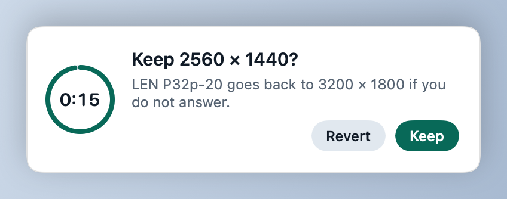

<sub>[User guide](../user-guide.md) › Text size and resolution</sub>

# 🔠 Text size, resolution and rotation

Pick how large things look on each display, from every size it can show, including the sharp HiDPI sizes macOS leaves out of its own list.

| Panel | Display page | Keys | Settings | Command line |
|:-:|:-:|:-:|:-:|:-:|
| Text size | Refresh rate, rotation, shortcuts | Your own shortcuts | — | Everything, plus favourites |

### Change the text size

1. Open the panel. Each card has a **text-size strip**: larger text on the left, more space on the right.
2. Point at a step to see the size it gives, under the strip. The dot marks the display's default.
3. Click a step. The display changes at once.
4. A small window asks **Keep** or **Revert**. Press <kbd>Return</kbd> to keep, <kbd>Esc</kbd> to go back.

<p align="center">
<picture>
  <source media="(prefers-color-scheme: dark)" srcset="../assets/keep-size-dark.webp">
  
</picture>
</p>

> [!TIP]
> Not answering is safe. After 15 seconds the display goes back to the size it had, by itself. If the app crashes while it waits, the change is undone at the next start.

### Refresh rate and rotation

On the display's page, under **Picture**:

| Control | Choices | Asks Keep or Revert |
|---|---|:-:|
| **Refresh rate** | The rates at the current size, 59.94 and 60 kept apart | ✓ |
| **Rotation** | 0°, 90°, 180°, 270° | ✓ |

### Keep a size or rotation in place

If something else keeps changing a display's size or rotation, switch on **Put this size back when something changes it** or **Put this rotation back when something changes it** on its page, under Options. The app puts it back after a wake, a reconnect or a change made elsewhere, says so on screen, and stops after three tries in two minutes. Off by default.

### Shortcuts for sizes

On the display's page, **Options → Shortcuts → Add** records a global shortcut for **More Space…**, **Larger Text…** or **Rotate…**. Repeated presses are gathered into one change.

### From the command line

```sh
display16x get resolution --main
display16x set resolution 2560x1440 --tag 1 --try        # asks Keep or Revert
display16x set resolution "1920x1080 hidpi @60" --tag 1
display16x set resolution default --tag 1                # or native, previous, largest, smallest
display16x step resolution +1 --tag 1                    # one step towards more space
display16x keep --tag 1                                  # or: display16x revert --tag 1
display16x set refreshRate 50 --tag 2
display16x set rotation 90 --tag 2 --try
display16x step rotation +1 --tag 2                      # turn by 90°
display16x set favourites add --tag 1                    # save the mode in use
display16x set resolution favourite:1 --tag 1
display16x get modes --tag 1                             # every mode, as JSON
```

A size that does not exist exactly gets the nearest one, and the reply says how it differs. Add `--exact` to refuse anything else. Changing the size of a display that mirrors another is off unless you allow it: `display16x set mirrorTargetSizes on`.

### Good to know

> [!NOTE]
> - The text-size strip, Keep, Revert and the revert on its own were checked on hardware with both test monitors.
> - Rotation ran once on hardware: 90° on one monitor, left unanswered, and it turned back after 15 seconds with the arrangement unchanged. Keep and the other angles were not run.
> - Putting a size or rotation back is unit-tested.
> - The full size list comes from a private macOS interface. If a macOS update removes it, the app falls back to the public list, which lacks some scaled sizes.
> - For sizes the display does not offer at all, see [More sizes](more-sizes.md).

<p align="center"><sub><a href="brightness-and-volume.md">← Brightness and volume</a> · <a href="../user-guide.md">User guide</a> · <a href="arrangement.md">Arrangement →</a></sub></p>
