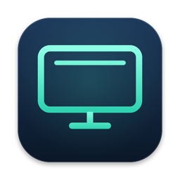

# Display 16X user guide

Everything the app can do, by what you want to do.

<table>
<tr>
<td width="33%" valign="top">

🧭 **[The panel](guide/panel.md)** 
Cards, a display's page, what the menu bar icon tells you

</td>
<td width="33%" valign="top">

☀️ **[Brightness and volume](guide/brightness-and-volume.md)** 
Brightness, contrast, volume, dimming, the keys

</td>
<td width="33%" valign="top">

🔠 **[Text size and resolution](guide/text-size.md)** 
Sizes, refresh rate, rotation, Keep or Revert

</td>
</tr>
<tr>
<td valign="top">

🖥️ **[Arrangement](guide/arrangement.md)** 
Your desk, the main display, mirroring, disconnect

</td>
<td valign="top">

🎬 **[Scenes, shortcuts and links](guide/scenes-and-shortcuts.md)** 
One press for a whole setup

</td>
<td valign="top">

🌈 **[HDR and color](guide/hdr-and-color.md)** 
HDR, color profiles, Night Shift in HDR

</td>
</tr>
<tr>
<td valign="top">

🔍 **[More sizes](guide/more-sizes.md)** 
Overrides, virtual screens, HiDPI on any panel

</td>
<td valign="top">

🎨 **[Skins](guide/skins.md)** 
Six looks, or your own two colors

</td>
<td valign="top">

⚙️ **[Settings](guide/settings.md)** 
Every tab, and where your settings live

</td>
</tr>
<tr>
<td valign="top">

💻 **[Command line](guide/command-line.md)** 
Every command, with recipes

</td>
<td valign="top">

🛟 **[Help and safety](guide/troubleshooting.md)** 
Permissions, undo, safe mode, fixes, removal

</td>
<td valign="top">

📦 **[Install](install.md)** 
Homebrew, the ZIP, the first launch

</td>
</tr>
</table>

## First five minutes

1. **Install** with `brew install --cask engrmnaveed/tap/display16x`, then allow the first launch. The [install guide](install.md) shows how.
2. **Click the display icon** in the menu bar. Each display has a card.
3. **Drag the ☀ bar** on a monitor's card. That is its own backlight.
4. **Click a step** on the text-size strip, then **Keep**, or let it go back by itself.
5. **Grant Accessibility** when the panel asks, and your keyboard's brightness keys reach the monitor under the pointer.

## Words used in this guide

| Word | Means |
|---|---|
| **The panel** | What opens from the menu bar icon: one card per display |
| **A display's page** | Everything about one display, one level down. Open it with the sliders button on its card |
| **Keep or Revert** | The small window after a change to size, rotation, layout, HDR or a profile. Unanswered, it goes back after 15 seconds |
| **Tag** | A small number the app gives each display, for the command line: `--tag 2` |
| **DDC** | The channel a Mac uses to set a monitor's own brightness, contrast and volume. Each monitor decides what it accepts |
| **Off until you switch it on** | HDR, color and More sizes do nothing until you turn them on in **Settings → Advanced** |

## How sure is each feature?

Every page ends with **Good to know**, which says plainly what was checked on real monitors and what has run only in unit tests so far. The test desk is an Apple M5 Pro with macOS 27.2.1, a Lenovo P32p-20 on HDMI and an LG SDQHD on USB-C. The [feasibility notes](feasibility.md) hold every measurement, and the [changelog](../CHANGELOG.md) says what each release checked.
